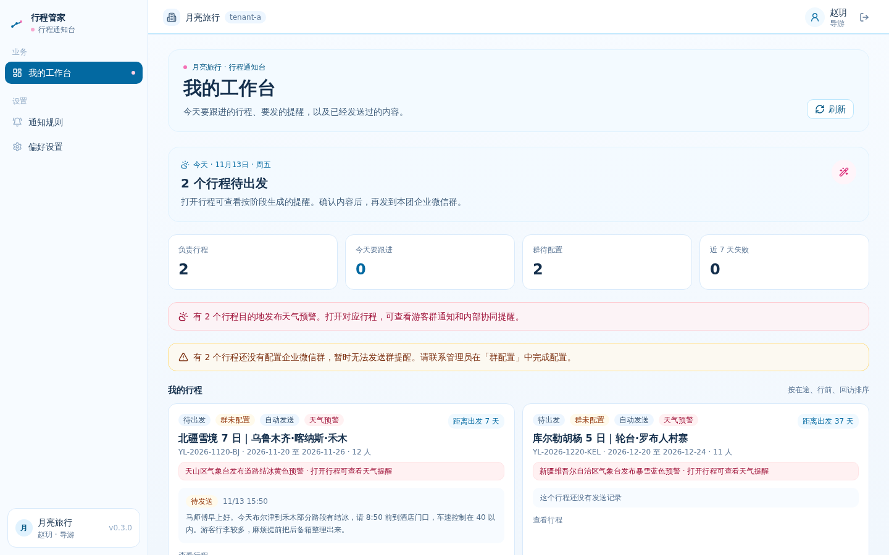
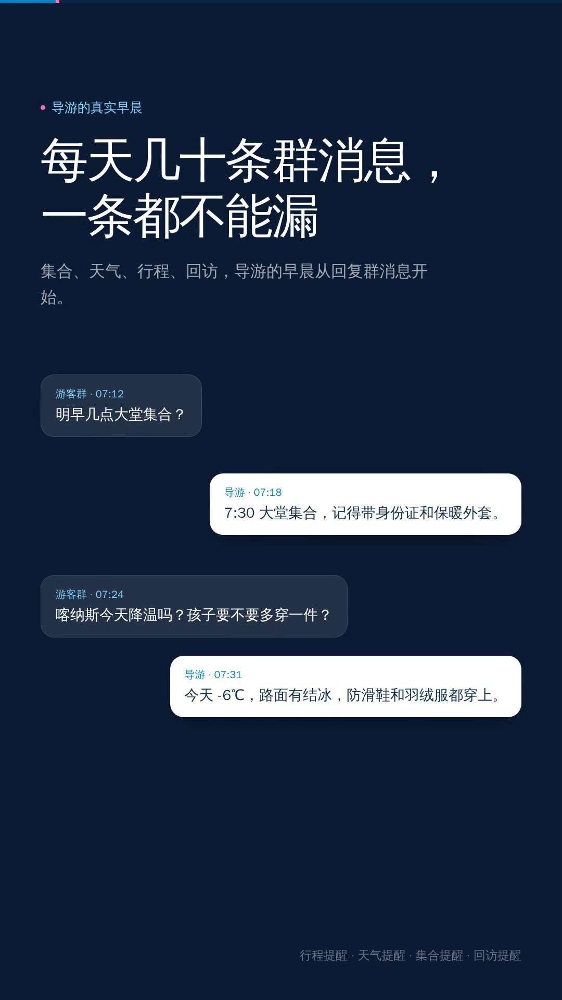

# 行程管家｜旅行社的行程通知工作台

月亮旅行出品。把行前、行中、行后的游客提醒排好，发到企业微信群；管理员能看到每位导游发了什么、有没有送达。

游客不用安装 App，导游不用每天复制粘贴，管理员也不用在群里一条条翻记录。

## 导游每天要发多少条消息

一个新疆多日团，从报名到结束，通常要发这些提醒：

- 行前 3 天：证件、航班、行李、天气
- 行前 1 天：集合时间、领队电话、最终确认
- 行程中每天早上：今日安排、天气、穿衣、集合
- 行程中每天中午：用餐、休息、下午集合
- 行程中每天晚上：次日行程、酒店、退房提醒
- 行程结束后：欢送词、满意度回访

一个导游同时带几个团时，消息很容易漏；管理员也很难确认每个团到底发没发、发得对不对。

## 行程管家怎么解决

**1. 按团生成完整发送计划**

系统根据行程日期，把行前、行中、行后要发的消息按时间排好。每条提醒都结合当天行程、酒店、天气和目的地注意事项生成。

**2. 自动发送，或等导游确认**

每个团可以单独设置：

- **自动发送**：到点直接发到本团企业微信群
- **需我确认**：系统只生成计划，导游检查、修改后再发

不熟悉的团、天气变化大的团，可以先设为「需我确认」。

**3. 管家、司导、司机分岗位发送**

团期负责人、旅行管家、司机各有一套早间和午间话术，可以独立编辑、独立发送，也可以分别发到本团群、单独的群或手机号。

**4. 管理员看得见执行情况**

团队执行页按导游展开：

- 负责哪些团
- 每个团最近发了什么
- 发送人是谁
- 发送成功还是失败
- 哪些团还没有配置企业微信群

**5. 天气变化时，提醒能跟上**

目的地出现暴雪、道路结冰、大风、沙尘等预警时，系统会同时准备：

- 给游客群的天气提醒
- 给司导、管家的内部协同提醒

导游确认后再发送。

**6. 手机和电脑都能用**

导游在手机上打开工作台，看今天要跟进的团、改文案、发消息；管理员在电脑上看团队执行和通知记录。

## 适合谁

- 做新疆多日游、定制团、包车团的旅行社
- 一个导游同时带多个团的导游团队
- 需要远程检查导游是否按时发消息的计调和老板
- 想让游客体验更稳定、又不想增加人工的旅行社

## 使用流程

1. 管理员建团，填写行程、游客和工作人员，分配导游
2. 在「群配置」里填入本团企业微信群机器人地址
3. 系统按行前、行中、行后生成发送计划
4. 导游在手机上确认或修改，发送到群
5. 管理员在「团队执行」查看每位导游的发送内容和送达结果

## 产品截图

| 导游工作台 | 发送计划 | 团队执行 |
|---|---|---|
|  |  |  |

## 宣传视频

[观看 41 秒竖屏宣传片](promo/xingcheng-guanjia-promo-vertical.mp4)

适合抖音、小红书、视频号发布。发布文案和分镜见 [promo/README.md](promo/README.md)。

## 了解更多

- 本地体验与演示数据：[docs/qa/README.md](docs/qa/README.md)
- 部署与上线：[docs/commercial-deployment.md](docs/commercial-deployment.md)
- 宣传视频制作说明：[promo/README.md](promo/README.md)

如需预约演示或合作，请通过仓库主页联系方式联系项目维护者。
