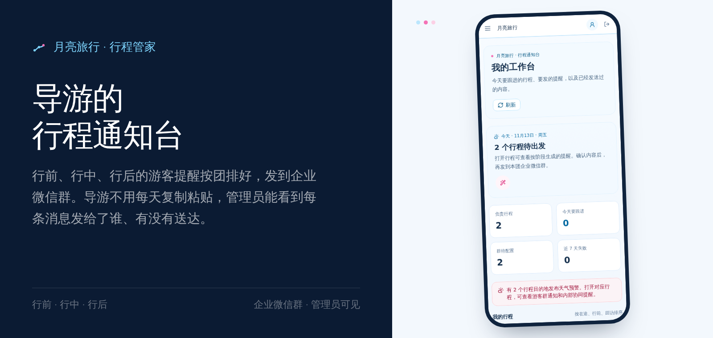
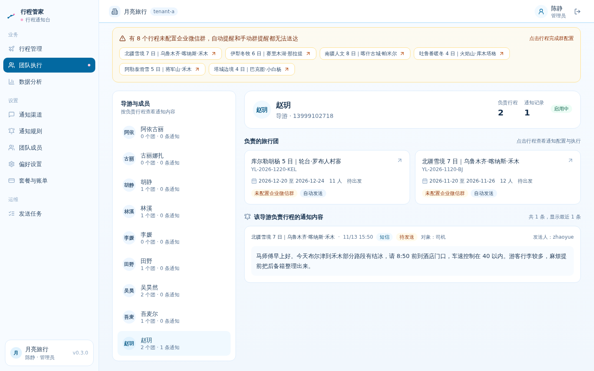
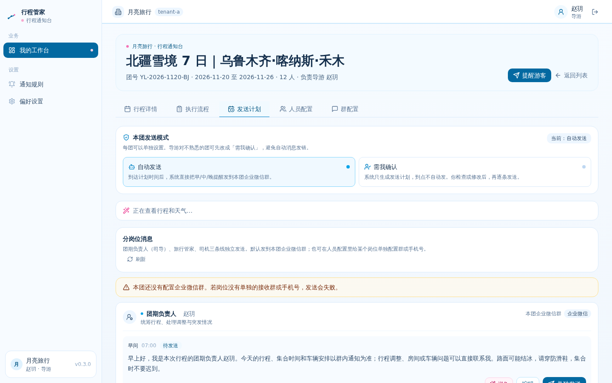
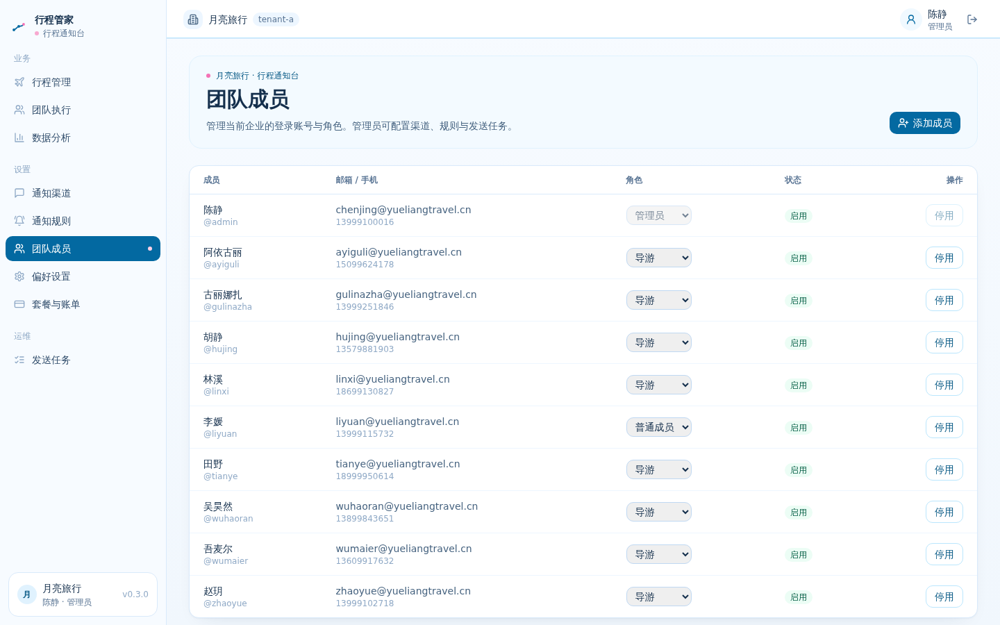

# 行程管家｜旅行社和导游的行程通知工作台

> 月亮旅行出品。行前、行中、行后的提醒按团排好，发到企业微信群。导游少做重复的事，管理员看得见执行结果。

## 这个产品是给谁用的

### 给旅行社老板和计调

旅行团出发后，最怕的不是没发消息，而是不知道导游到底发没发、发得对不对。

客户在群里问“明天几点集合”，你才发现昨天的次日行程没人发；等到投诉，已经晚了。

行程管家把每个团的执行情况放到一个页面里：

- 哪位导游负责哪些团
- 每个团最近发了什么
- 发送人是谁、发送成功还是失败
- 哪些团还没有配置企业微信群

你不用每天在几个群里翻聊天记录，也能知道每个团走到哪一步。

### 给导游和司导

一个导游同时带两三个团，是常态。

早上要发集合和天气，中午要提醒用餐和休息，晚上要发次日行程；遇到下雨、降温、道路结冰，还要临时补一条。

这些消息并不难写，难的是每天都记得、每个团都不发错。

行程管家把导游每天要做的事收进一个工作台：

- 今天要跟进哪些团，一屏看完
- 行前、行中、行后要发什么，按时间排好
- 每条消息可以先改再发
- 不熟悉的团可以设为「需我确认」
- 团期负责人、旅行管家、司机可以分岗位发送

导游打开手机就知道今天发什么，不用再从以前的聊天记录里复制粘贴。

### 给游客

游客不需要安装新的 App，也不需要加另一个系统。

提醒还是发在原来的企业微信群里，只是内容更完整、时间更稳定：

- 出发前知道证件、航班和集合信息
- 每天早上知道天气、穿衣和集合时间
- 中午知道用餐和下午安排
- 晚上知道第二天去哪、住哪
- 行程结束后收到回访

## 为什么不用微信群加 Excel

微信群还是照常发，但群消息不会提醒你“这个团今天还没发”，也不会告诉你“这条消息有没有送达”。

Excel 可以排行程，但不会到点提醒，也不方便导游在手机上改一句话就发出去。

行程管家做的是中间这一段：

> 把每个团要发的消息排好，交给导游确认，再把发送结果留下来。

## 一天是怎么运转的

| 时间 | 游客收到什么 | 导游要做什么 |
|---|---|---|
| 出发前 3 天 | 证件、航班、行李、天气和行前准备 | 检查信息，补充本团注意事项 |
| 出发前 1 天 | 集合时间、领队电话、最终确认 | 确认航班和酒店，发最终通知 |
| 行程中 07:00 | 今日安排、天气、穿衣、集合时间 | 确认后发到群 |
| 行程中 12:30 | 用餐、休息、下午集合提醒 | 确认后发到群 |
| 行程中 20:00 | 次日行程、酒店、退房提醒 | 检查第二天安排 |
| 行程结束后 | 欢送词、满意度回访 | 发回访，记录游客反馈 |

## 三个常见场景

**一个导游带三个团**

工作台按“今天要跟进”的顺序排好，先处理哪个团、每个团发什么，一眼能看见。

**天气突然变化**

目的地出现暴雪、道路结冰、大风、沙尘等预警时，系统同时准备游客群通知和内部协同提醒。导游确认后再发，不用临时想措辞。

**新导游上手**

行前、行中、行后的模板已经准备好，新导游不用背话术；不熟悉的团可以先设成「需我确认」，检查一遍再发。

## 产品能力

- 按团生成行前、行中、行后发送计划
- 每个团独立设置「自动发送」或「需我确认」
- 团期负责人、旅行管家、司机分岗位消息
- 企业微信群发送，游客不用安装 App
- 天气预警与内部协同提醒
- 管理员查看每位导游负责的团、实际内容和送达状态
- 手机端和电脑端都能使用
- 多企业独立空间，成员按角色查看不同内容
- 套餐、短信额度和账单管理

## 产品界面

| 导游工作台 | 发送计划 |
|---|---|
|  |  |

| 团队执行 | 团队成员 |
|---|---|
|  |  |

以上截图使用演示数据，姓名、行程和电话均为虚构。

## 宣传视频

[观看 41 秒竖屏宣传片](promo/xingcheng-guanjia-promo-vertical.mp4)

适合抖音、小红书、视频号发布。发布文案和分镜见 [promo/README.md](promo/README.md)。

## 了解更多

- 本地体验与演示数据：[docs/qa/README.md](docs/qa/README.md)
- 部署与上线：[docs/commercial-deployment.md](docs/commercial-deployment.md)
- 宣传视频制作说明：[promo/README.md](promo/README.md)

如需预约演示或合作，请通过仓库主页联系方式联系项目维护者。
